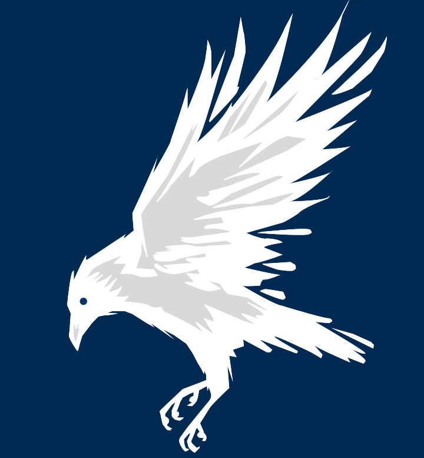

# Corvus Design by wen
## À propos

Corvus est mon terrain d'expérimentation : j'y rassemble mes projets (logos, identités visuelles, interfaces) et j'y teste des idées sans contrainte. 

Le nom vient du latin *corvus*, qui signifie "corbeau".

Plus qu'un simple mot, corvus possède une dimension symbolique : le corbeau étant souvent associé à l'intélligence, l'observation, le mystère et à la transformation dans différentes cultures.

C'est tout pour l'instant ! 

Retrouvez le projet sur : https://corvus-design.vercel.app/

